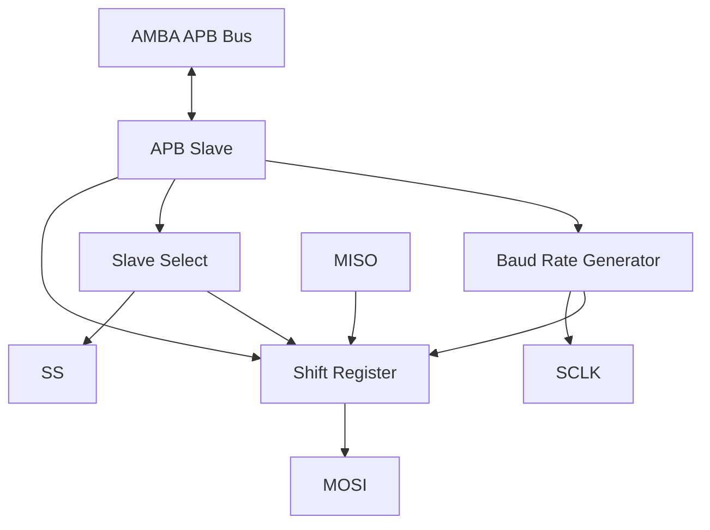
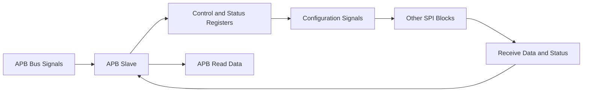
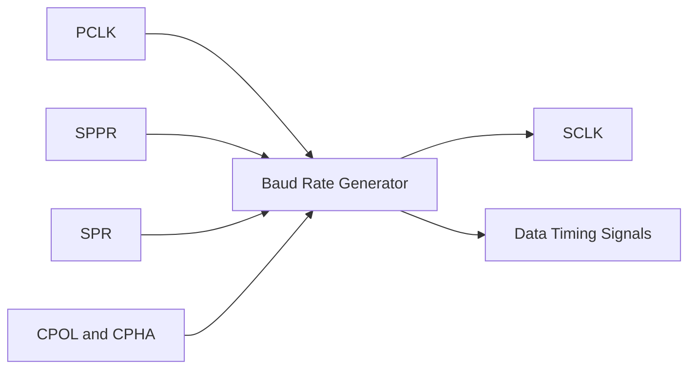
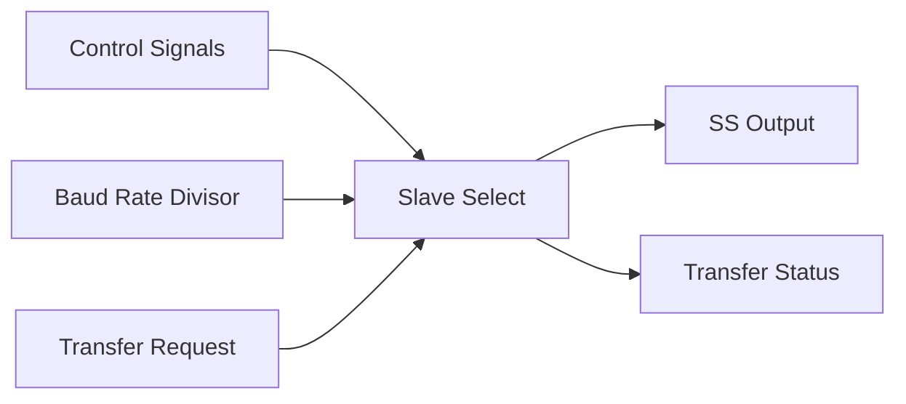
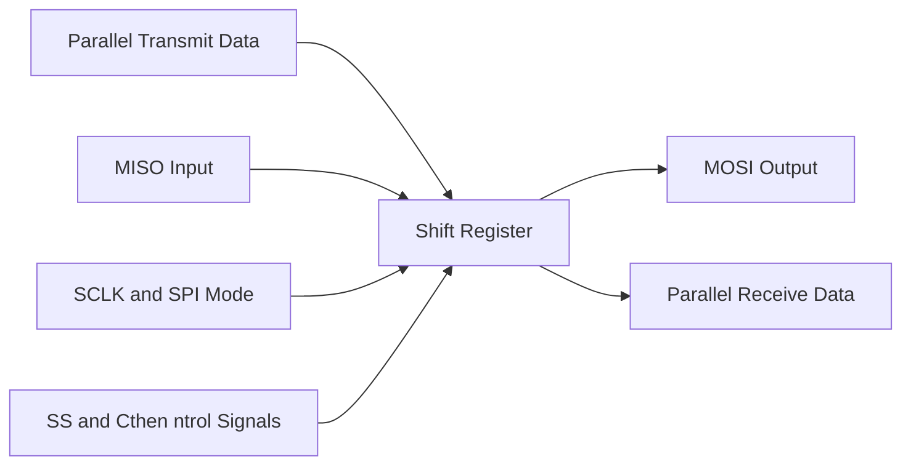

# APB-Based SPI Master IP Design and Verification

## Project Overview

This project focuses on the design and functional verification of an **APB-Based SPI Master IP** using Verilog HDL. The design integrates the AMBA Advanced Peripheral Bus (APB) interface with the Serial Peripheral Interface (SPI) protocol to support register configuration, serial data transmission, and data reception.

The design is organized into modular RTL blocks to simplify development, integration, and verification.

## Objectives

- Design an SPI Master IP using Verilog HDL.
- Interface the SPI controller with the AMBA APB protocol.
- Implement configurable SPI clock generation.
- Support serial data transmission and reception.
- Integrate the individual RTL modules into a complete top-level design.
- Verify module functionality through simulation using ModelSim.

## Overall Architecture

The design consists of four main sub-blocks:

1. APB Slave
2. Baud Rate Generator
3. Slave Select
4. Shift Register

The APB Slave handles register access and control, the Baud Rate Generator produces SPI timing signals, the Slave Select block manages the slave-select signal, and the Shift Register handles serial data transmission and reception.

### Overall Block Diagram



## Sub-Block Descriptions

### 1. APB Slave

**Description:**

The APB Slave provides the interface between the AMBA APB bus and the SPI Master IP. It handles APB read and write transactions and provides access to control and status registers.

**Key Functions:**

- Handles APB read and write operations.
- Provides access to SPI control and status registers.
- Supplies configuration and control signals to other SPI blocks.
- Makes received data and status information available to the APB interface.

**Block Diagram:**



### 2. Baud Rate Generator

**Description:**

The Baud Rate Generator generates the SPI serial clock (SCLK) using the peripheral clock and configurable baud-rate divider settings. It also provides timing signals for data transmission and reception.

**Key Functions:**

- Generates the SPI serial clock.
- Uses the SPPR and SPR configuration fields to determine the clock divider.
- Supports SPI clock polarity (CPOL) and phase (CPHA) configuration.
- Generates timing signals for serial data shifting and sampling.

**Block Diagram:**



### 3. Slave Select

**Description:**

The Slave Select block manages the SPI slave-select signal during data transfers. It coordinates slave selection and transfer status using control signals and baud-rate timing information.

**Key Functions:**

- Controls the slave-select (SS) signal.
- Coordinates the start and completion of SPI transfers.
- Tracks transfer progress using timing and counter logic.
- Provides transfer status information to the controller.

**Block Diagram:**



### 4. Shift Register

**Description:**

The Shift Register manages the parallel-to-serial conversion of transmit data and serial-to-parallel conversion of received data. It transmits data through MOSI and receives data through MISO according to the configured SPI timing and bit order.

**Key Functions:**

- Transmits serial data through MOSI.
- Receives serial data through MISO.
- Supports configurable SPI clock polarity and phase.
- Supports configurable data bit order.
- Provides received parallel data to the APB Slave interface.

**Block Diagram:**



## Repository Structure

```text
APB-Based-SPI-Master-IP-Design-Protocol/
│
├── APB_Slave/
│   ├── APB_Slave.v
│   └── APB_Slave_tb.v
│
├── Baudrate_generator/
│   ├── Baud_generator.v
│   └── Baud_generator_tb.v
│
├── Shift_Register/
│   ├── Shift_register.v
│   └── Shift_register_tb.v
│
├── Slave_Select/
│   ├── Slave_Select.v
│   └── Slave_Select_tb.v
│
├── Top_Module/
│   ├── Topmodule.v
│   └── Topmodule_tb.v
│
└── README.md
```

*Note: Adjust the filenames in this structure to match the actual files in your repository.*

## Technologies Used

- **Hardware Description Language:** Verilog HDL
- **Bus Protocol:** AMBA APB
- **Serial Communication Protocol:** SPI
- **Simulation Tool:** ModelSim
- **Design Methodology:** RTL Design and Functional Verification

## Verification

The RTL modules are tested individually and integrated into a top-level design for functional verification using Verilog testbenches and ModelSim simulation.

The main verification objectives include:

- APB read and write transactions.
- SPI clock generation and divider configuration.
- Slave-select control during data transfers.
- Serial data transmission through MOSI.
- Serial data reception through MISO.
- Integration and interaction of the individual RTL blocks.

Simulation waveforms are used to observe signal timing, control behavior, and data transfer.

## Learning Outcomes

- Understanding AMBA APB bus transactions and register access.
- RTL design and modular coding using Verilog HDL.
- SPI clock generation and timing control.
- Serial-to-parallel and parallel-to-serial data conversion.
- RTL integration, testbench development, and waveform analysis.

## Author

**Prameela**

